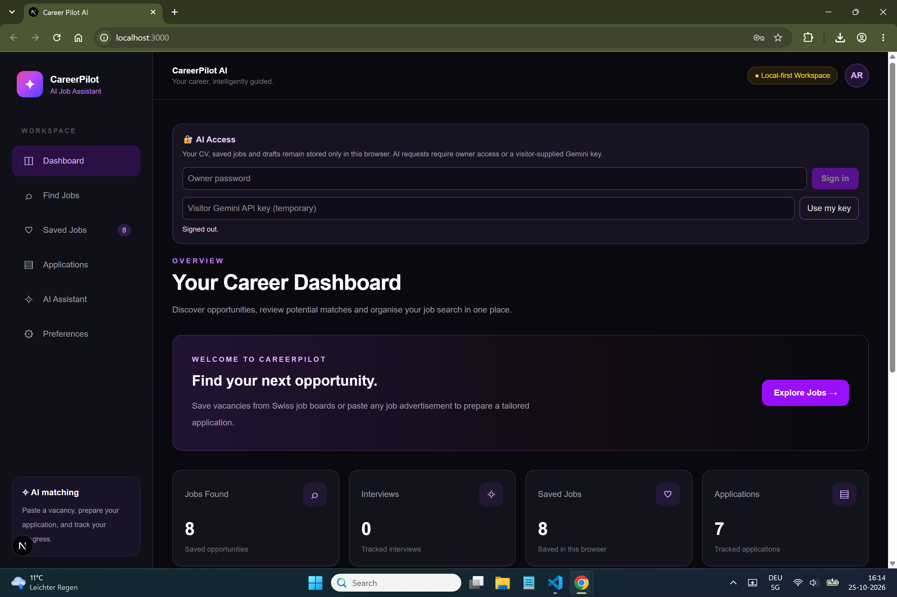
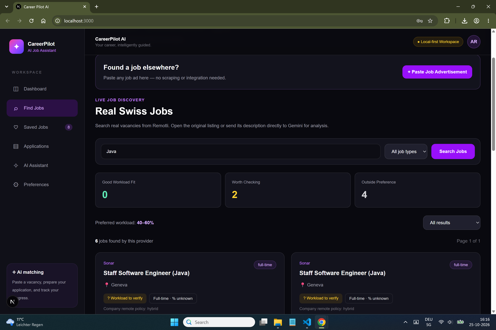
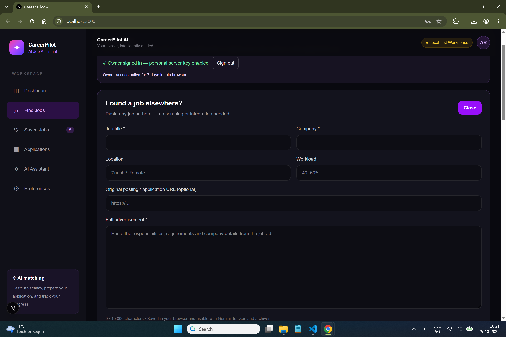
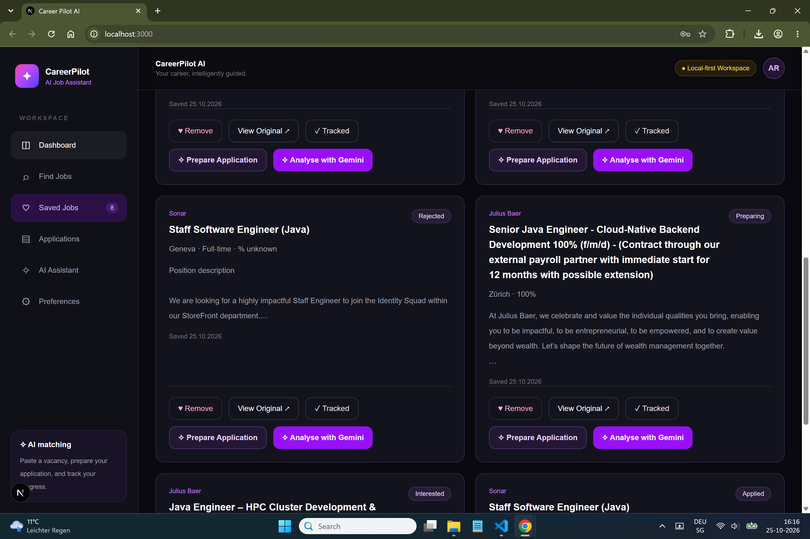
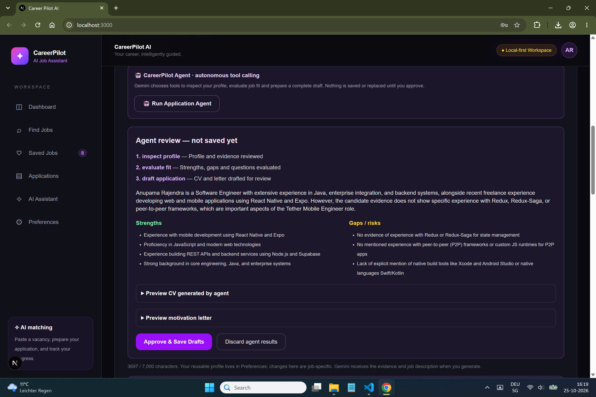
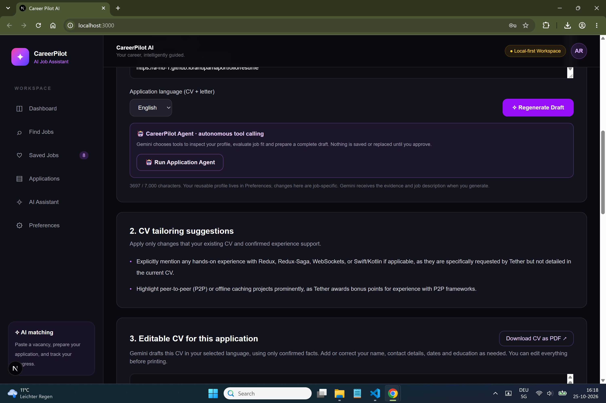
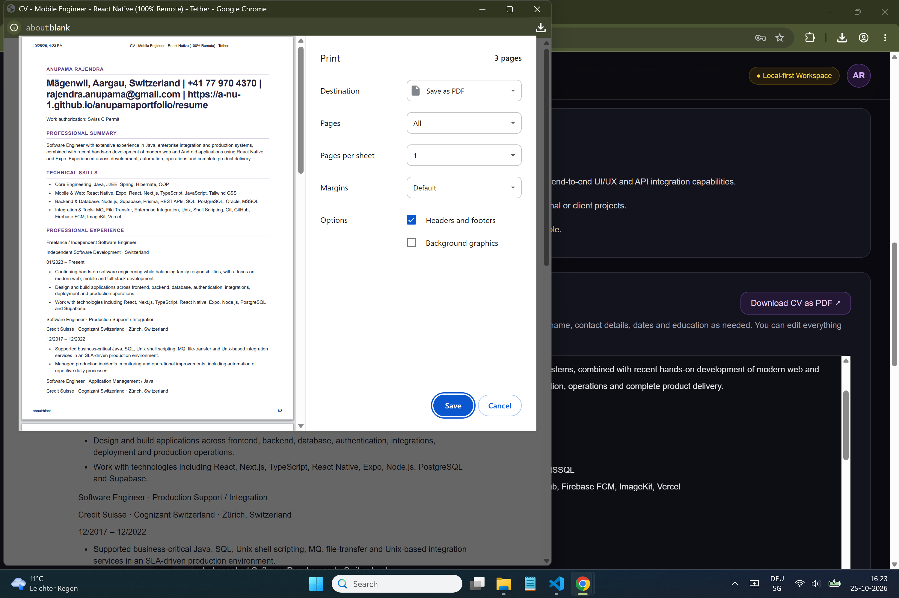
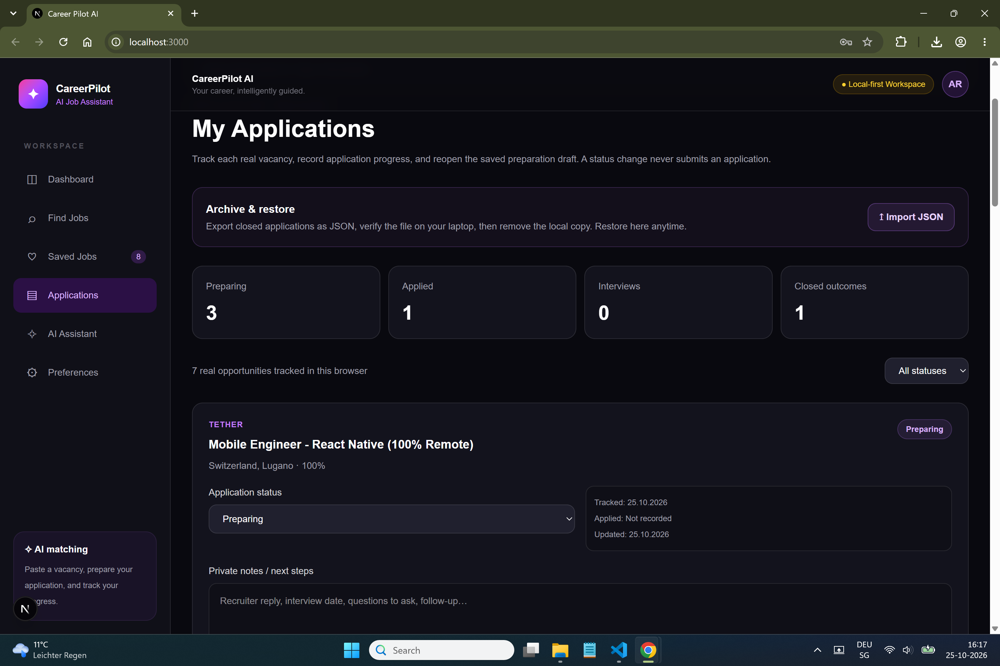

# CareerPilot AI

# Live at: https://careerpilot-ai-eta-ten.vercel.app/ 

A local-first, AI-assisted job application workspace built with **Next.js (App Router), React, TypeScript, Tailwind CSS, and Google's Gemini API**.

CareerPilot helps you discover Swiss job listings, paste vacancies from other websites, compare a vacancy with your confirmed experience, prepare English/German CVs and motivation letters, and manage the application lifecycle.

## Features

- Browse Remotli vacancies, or paste any job advertisement manually.
- Save real/manual vacancies with tracking status and notes.
- Analyse vacancy requirements and candidate fit with Gemini.
- Maintain one reusable, editable career profile.
- Generate editable, job-specific CVs and motivation letters in English or Swiss-standard German.
- Print professional A4 application PDFs using your browser's **Save as PDF** destination.
- Run a bounded, Gemini function-calling agent with profile inspection, fit evaluation and application drafting tools. **Human approval is required before saving agent results.**
- Track applications: Interested, Preparing, Applied, Interview, Offer, Rejected and Withdrawn.
- Export individual completed applications as JSON, remove them locally, and restore them later.
- Export/import a full backup of CareerPilot browser data; display approximate local storage use.
- Owner password authentication with server-side Gemini key and a visitor **Bring Your Own Key** option (visitor key kept in browser memory).

## Application flow

**Find or paste → Save → Analyse → Prepare → Review → Export PDFs → Apply yourself → Track → Archive**

CareerPilot **does not submit applications to employers** or claim an application was submitted automatically.

## Local setup

Prerequisites: recent Node.js LTS and npm. Install dependencies using the project's `package.json`.

```bash
npm install
npm run dev
```

Create `.env.local` in the project root:

```dotenv
GEMINI_API_KEY=your_key_here
CAREERPILOT_OWNER_PASSWORD=your_unique_strong_password
CAREERPILOT_SESSION_SECRET=your_random_32_byte_hex_secret
```

Generate the session secret:

```bash
node -e "console.log(require('node:crypto').randomBytes(32).toString('hex'))"
```

Do **not** commit `.env.local` or expose secrets in `NEXT_PUBLIC_` variables. Run `npm run lint` and `npm run build` before deployment.

## Architecture

- **Frontend:** Next.js App Router client components; Tailwind styling.
- **Application persistence:** browser `localStorage` via `usePersistentState` (per browser and origin).
- **AI:** Next.js server route handlers call Gemini. Request input is validated and documents require human review.
- **Agent:** Gemini function declarations; controlled server-side execution; max five orchestration turns; no autonomous submissions.
- **Authentication:** signed HttpOnly owner session cookie, with personal Gemini API key held only on the server. Visitors can use their own temporary key.
- **Documents:** browser-native print to PDF; no paid PDF API.

## Privacy and limitations

- Saved jobs, career evidence and drafts stay in **this browser's localStorage**, not a database. Changing computers or moving from localhost to Vercel requires a JSON export/import.
- Your submitted career evidence and job descriptions are sent to the Gemini API when you use AI features.
- JSON backups contain personal career information in plain text: protect these files.
- Review generated CVs and letters for invented skills, dates or qualifications before submitting them.
- LocalStorage is not encrypted or synchronized, and may be erased when browser/site data is cleared.
- Public deployment needs appropriate abuse protection for login attempts and AI requests; a password alone does not provide rate limiting.
- Gemini access depends on the provider's quotas and terms. No-cost infrastructure is a design goal, not a guarantee of unlimited free inference.

## Deployment

1. Check the Git status and ensure no secrets are tracked: `git status` and `git ls-files .env.local` (the latter should print nothing).
2. Run `npm run lint` and `npm run build`.
3. Export your local CareerPilot backup from **Preferences**.
4. Push your repository to GitHub.
5. Import the repository into Vercel; configure `GEMINI_API_KEY`, `CAREERPILOT_OWNER_PASSWORD`, and `CAREERPILOT_SESSION_SECRET` in Vercel's environment settings.
6. Deploy, verify owner sign-in, owner-only AI, visitor BYOK, PDF export, backup restore, and logout.
7. Review managed WAF/bot protection and login rate limiting before publishing widely. Avoid restricting normal owner AI usage unnecessarily.

## Screenshots

The screenshots below demonstrate the end-to-end application workflow. All candidate information shown should be fictional or anonymised.

### 1. Dashboard
Overview of saved vacancies, application progress, and the main workspace.



### 2. Discover jobs
Search available vacancies and review their suitability for your preferred workload and location.



### 3. Paste an external vacancy
Bring job advertisements from other websites into CareerPilot without web scraping.



### 4. Saved vacancies
Manage real and manually imported jobs with clear application-status labels.



### 5. Gemini application agent
A bounded function-calling workflow inspects candidate evidence, evaluates fit, and drafts materials for human approval.



### 6. Tailored CV preparation
Generate and edit job-specific CVs in English or Swiss-standard German, with supporting fit recommendations.



### 7. Professional PDF export
Export a formatted A4 CV or motivation letter using the browser's Save as PDF feature.



### 8. Application tracker
Update application status, record notes and dates, and archive completed applications as JSON.



> **Privacy:** Use a fictional candidate profile, anonymised job notes, and sample letters for public screenshots. Never show real API keys, passwords, session cookies, private contact details, or sensitive CV content.

## Tech highlights

TypeScript · Next.js · React · Gemini LLM · Tool/function calling · Human-in-the-loop approval · REST API routes · local-first architecture · document exports · security-minded API design.

---

## 👩‍💻 Author

**Anupama Rajendra**  
Software Engineer | Full-Stack Developer | AI-Assisted Application Development

Computer Science Engineer with 10+ years of professional IT experience in enterprise application development, application management, and production support in Switzerland.

Currently building modern web and mobile applications using React, Next.js, TypeScript, Node.js, PostgreSQL, and AI technologies.

**CareerPilot AI** is a personal project developed to explore large language models (LLMs), Gemini function calling, AI agent orchestration, and practical AI-powered workflows.

This project reflects my interest in combining traditional software engineering principles with modern AI technologies to solve real-world problems.

**GitHub:** [A-nu-1](https://github.com/A-nu-1)  
**Portfolio:** [Anupama Rajendra](https://a-nu-1.github.io/anupamaportfolio/)

---

*Designed and developed with curiosity, continuous learning, and a passion for building useful software.*

**© 2026 Anupama Rajendra**